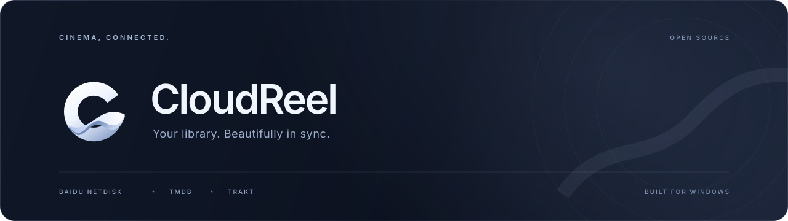

<p align="center">
  
</p>

<p align="center">
  <strong>把云端片库，变成你的私人影院。</strong><br />
  为 Windows 打造的百度网盘影视客户端，连接片库、元数据与观看进度。
</p>

<p align="center">
  
  
  
  <a href="LICENSE"></a>
</p>

<p align="center">
  <a href="#功能特色">功能特色</a> ·
  <a href="#快速开始">快速开始</a> ·
  <a href="#开发与构建">开发与构建</a> ·
  <a href="#参与贡献">参与贡献</a>
</p>

---

## 关于云映

CloudReel（云映）是一款开源的 Windows 影视客户端。通过应用内的百度官方网页登录，即可浏览网盘中的电影和剧集；配合 TMDB 元数据与 Trakt 观看同步，把散落在文件夹中的视频整理成海报片库。

项目从 Infuse、VidHub 的观影体验中获得灵感，采用 Electron、React、TypeScript 和 mpv 构建，围绕简洁的片库与一体化播放体验持续开发。CloudReel 是独立项目，与上述产品及服务提供方无隶属关系。

## 功能特色

| | 体验 |
| :--- | :--- |
| **云端直连** | 应用内登录百度网盘、读取目录、播放原文件，无需手动配置百度开发者应用。 |
| **海报片库** | TMDB 海报、背景、风格化标题与分集资料；简体中文优先，其次繁体中文、英文。 |
| **智能归纳** | 识别季集、嵌套目录与数字文件名；支持多版本归纳、手动匹配和增量扫描。 |
| **跨设备续看** | Trakt 登录授权、播放进度同步，以及单集、单季、整部的已观看／未观看标记。 |
| **精选与接续** | 每日五部精选轮播、继续观看、接下来观看、收藏与筛选。 |
| **一体化播放** | 内嵌 mpv、无须退出播放器的切集、字幕与音轨选择、倍速、播放偏好和自动连播。 |
| **真实媒体信息** | 从媒体读取分辨率、动态范围、音频格式与时长，配合文件大小展示，减少对文件名的依赖。 |
| **桌面质感** | 深色界面、浮层播放控件、鼠标键盘操作，以及适配窗口尺寸和 Windows 显示缩放的排版。 |

HDR 输出与色调映射取决于片源、Windows HDR 设置和显示设备。Dolby Vision 片源按播放器与显示环境的能力处理，不代表原生 Dolby Vision 输出或认证。

## 快速开始

### 环境要求

- Windows 10／11，x64。
- [Node.js 24 LTS](https://nodejs.org/) 和 [Git](https://git-scm.com/)。
- 能够访问依赖下载站点和所使用的账号、元数据服务。

当前验证环境为 Node.js **24.11.1**。其他操作系统和 CPU 架构暂未验证。

### 安装与运行

克隆仓库后，在项目根目录打开 PowerShell：

```powershell
# 按锁文件安装依赖
npm ci

# 准备桌面与播放运行库
npm run setup:desktop
npm run setup:mpv

# 使用项目的公开 Trakt 登录配置
Copy-Item config/services.example.json config/services.json

# 检查并启动开发版
npm run check
npm run dev
```

首次准备会下载 Electron、mpv 和 TinyCC。原生输入组件由脚本自动编译，无需安装 Visual Studio。已有 `config/services.json` 时请保留自己的配置。

### 第一次打开

1. 在应用内登录百度网盘，选择存放影片的目录并扫描。
2. 在设置中填写自己的 **TMDB API Read Access Token**，获取海报和影片资料；未配置时可使用公开数据源后备方案。
3. 登录 **Trakt**，启用观看进度和已观看状态同步。

TMDB 可在 [API 设置](https://www.themoviedb.org/settings/api) 中申请；百度网盘和 Trakt 的日常使用通过账号登录完成。源码附带项目登记的公开 Trakt Client ID 与回调地址，不包含个人令牌或 Client Secret。

## 开发与构建

### 常用命令

| 命令 | 用途 |
| :--- | :--- |
| `npm run dev` | 启动 Electron 开发版 |
| `npm run dev:web` | 仅预览前端界面；桌面登录和播放需在 Electron 中使用 |
| `npm test` | 执行自动化测试，包括隐藏窗口回归测试 |
| `npm run build` | 编译原生组件、生成图标、检查 TypeScript 并构建前端 |
| `npm run check` | 执行测试与完整构建 |
| `npm run verify:playback` | 隔离正式会话，在隐藏窗口验证真实百度网盘电影与剧集播放 |
| `npm run dist` | 打包 Windows x64 便携版 |

完成快速开始中的运行库和服务配置后，执行 `npm run dist`，产物位于：

```text
release/CloudReel-0.3.17-win-x64.exe
```

便携版包含所需运行库，使用者无需安装 Node.js。构建产物不提交到源码仓库，可通过 GitHub Releases 分发。

### 项目结构

```text
CloudReel/
├─ src/                 React 界面、片库与播放器控件
├─ electron/
│  ├─ core/             媒体识别、播放状态与核心逻辑
│  ├─ services/         网盘、元数据、同步与播放服务
│  └─ native/           Windows 原生输入组件源码
├─ assets/brand/        SVG 品牌图形和应用图标
├─ config/              公开服务配置示例
├─ scripts/             开发、运行库安装和构建脚本
├─ tests/               自动化测试与隐藏窗口 fixtures
└─ docs/                开发、迁移与 GitHub 上传说明
```

## 配置与数据

开发版和发行版默认使用独立的数据目录：

| 类型 | 路径 |
| :--- | :--- |
| 开发版 | `%APPDATA%/CloudReel-Dev` |
| 发行版 | `%APPDATA%/CloudReel` |
| 自定义 | 环境变量 `CLOUDREEL_DATA_DIR` 指定的目录 |

个人登录信息、TMDB Token、片库和观看记录保存在本机，不随源码上传。换电脑后重新登录账号，观看进度可通过 Trakt 同步。

`config/services.json` 是本机服务配置，已被 Git 忽略。若要使用自己的 Trakt 应用，可在复制示例配置后执行：

```powershell
npm run configure:trakt -- --client-id YOUR_PUBLIC_CLIENT_ID --redirect-uri https://your-domain.example/cloudreel/trakt/callback
```

## 参与贡献

欢迎通过 Issues 反馈问题、讨论功能，或提交 Pull Request。提交前请阅读 [开发说明](docs/DEVELOPMENT.md) 和 [AGENTS.md](AGENTS.md)，并运行 `npm run check`。

播放相关改动需要使用真实百度网盘片源，通过正式会话、媒体中继与播放器验证。自动化测试可补充验证，但不能代替真实片源验收。测试应使用隔离数据和隐藏窗口，不修改正式片库、观看记录或 Trakt 账号。

反馈问题时，附上应用版本、Windows 版本、复现步骤和已脱敏的错误信息。请勿提交 Token、Cookie、账号数据或带签名的媒体地址。

## 致谢

- [mpv](https://mpv.io/) — 视频播放与媒体处理。
- [Electron](https://www.electronjs.org/)、[React](https://react.dev/)、[TypeScript](https://www.typescriptlang.org/)、[Vite](https://vite.dev/) — 桌面应用与界面开发。
- [TMDB](https://www.themoviedb.org/) — 影片资料和图像。本项目使用 TMDB API，但未经 TMDB 认可或认证。
- [Trakt](https://trakt.tv/) — 观看记录与进度同步。
- [Lucide](https://lucide.dev/) — 界面图标。

## 许可证

CloudReel 自有源码采用 [MIT License](LICENSE)。第三方依赖、运行库和服务内容保留各自的许可证与使用条款；MIT 不替代这些组件的许可。分发包含 mpv 的构建时，请一并遵守其及所含组件的许可要求，详见 [mpv Copyright](https://mpv.io/copyright/)。
